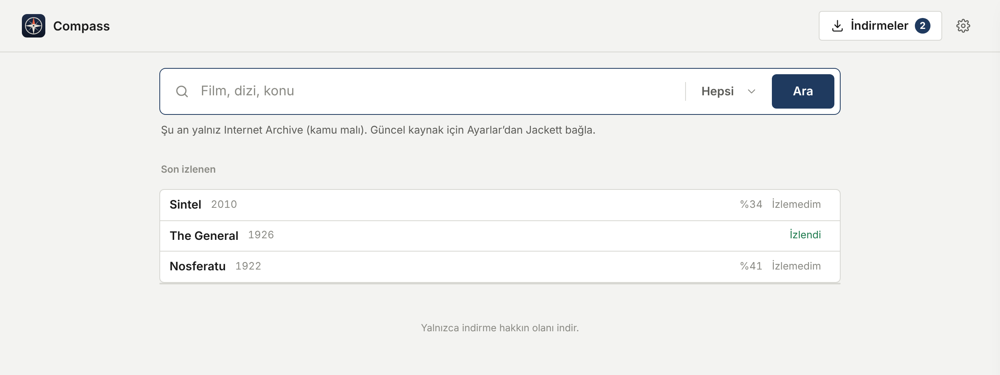
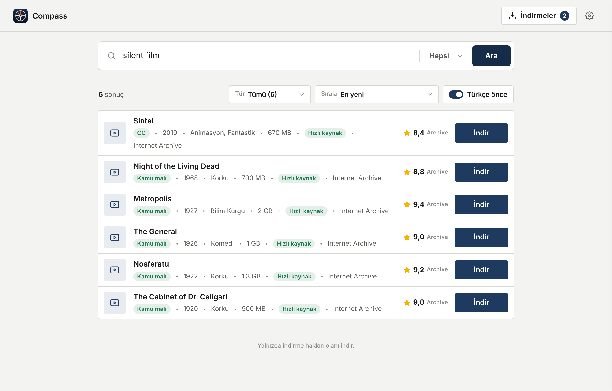
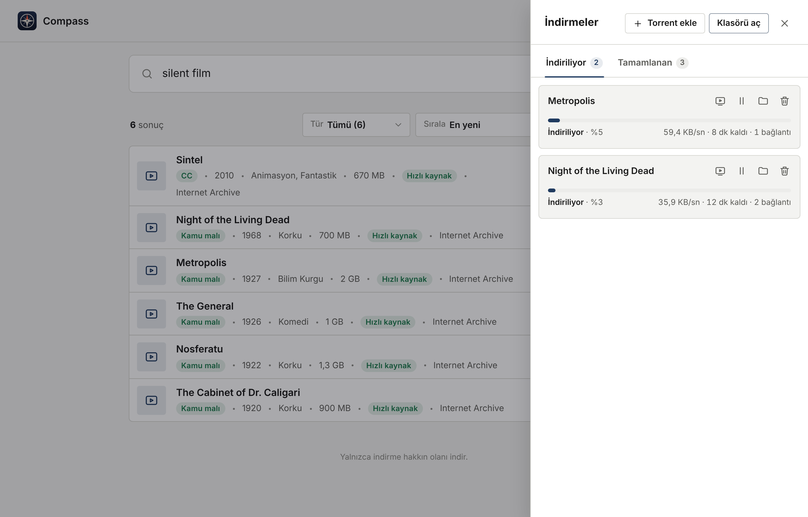
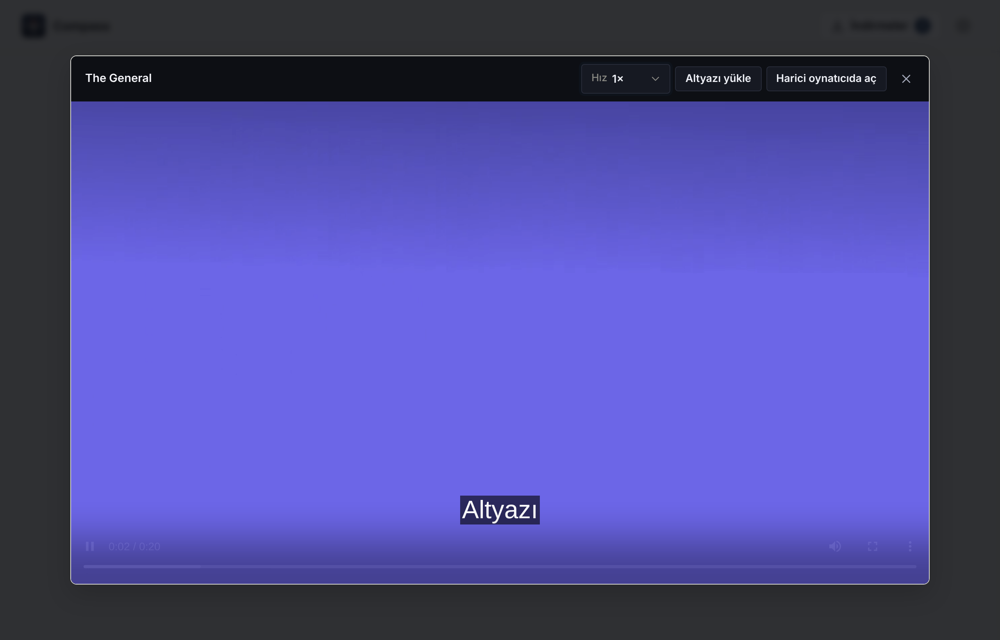

# Compass

Find a movie, series, album, or book, download it with one click, and start watching while it finishes.



Compass is a simple desktop app. You type what you're looking for, press **Ara** (Search), and press **İndir** (Download). That's it. The app's menus are in Turkish.

> Only download what you have the right to download. Out of the box, Compass searches the Internet Archive, which has public domain and freely licensed works.

## What you can do

**Search by name, topic, or genre.** Results show the year, genre, size, and a rating. Turkish results come first, and you can turn that off.



**Download with one click.** Downloads show progress, speed, and time left. If you close the app, unfinished downloads continue next time you open it.



**Watch right away.** The built-in player can start before the download is done. It remembers where you stopped, and you can load your own subtitles.



**Stay safe.** If a "movie" turns out to be a program (like an `.exe` file), Compass won't download it.

## Install

1. Install **qBittorrent**, the free program that does the actual downloading. Compass runs it in the background for you, so you never need to open it.
   - Windows: download it from [qbittorrent.org](https://www.qbittorrent.org/download).
   - Linux: the `.deb` installs it for you. With the `.AppImage`, run `sudo apt install qbittorrent-nox` first.
2. Download Compass from the [releases page](https://github.com/kaptanoguz/Compass/releases) and install it.
3. Open **Compass** from your application menu.

Your downloads go to a `Torrent` folder inside your Downloads folder. You can change this in Settings (the gear icon).

## Want more search results?

By default Compass only searches the Internet Archive, so you won't find new movies there. If you'd like to search other sites, you can connect **Jackett**, a free tool that lets Compass search them for you:

1. Install [Jackett](https://github.com/Jackett/Jackett) and open `http://127.0.0.1:9117`.
2. Click **+ Add indexer** and pick the sites you want.
3. Copy the **API Key** shown at the top right.
4. In Compass, open Settings (gear icon), click **+ Kendi indeksleyicini ekle** (Add your own indexer), paste the key, and save.

Once Jackett is connected, Compass also shows genre shortcuts on the home screen.

## For developers

Compass is written in Rust with [Tauri](https://tauri.app). The window shows the pages in `public/`, served by a small local server in `src-tauri/src/server.rs`. qBittorrent does the downloading.

You need Rust, Node.js 20 or newer, qBittorrent, and on Linux the WebKitGTK build libraries:

```bash
sudo apt install libwebkit2gtk-4.1-dev libayatana-appindicator3-dev librsvg2-dev qbittorrent-nox
npm install
npm start        # desktop app
npm test         # Rust tests; the download tests use qbittorrent-nox
npm run build    # installers into src-tauri/target/release/bundle/
```

New search sources go in `src-tauri/src/providers/` and are registered in `src-tauri/src/search.rs`.

## License

[MIT](LICENSE)
